<p align="center">
  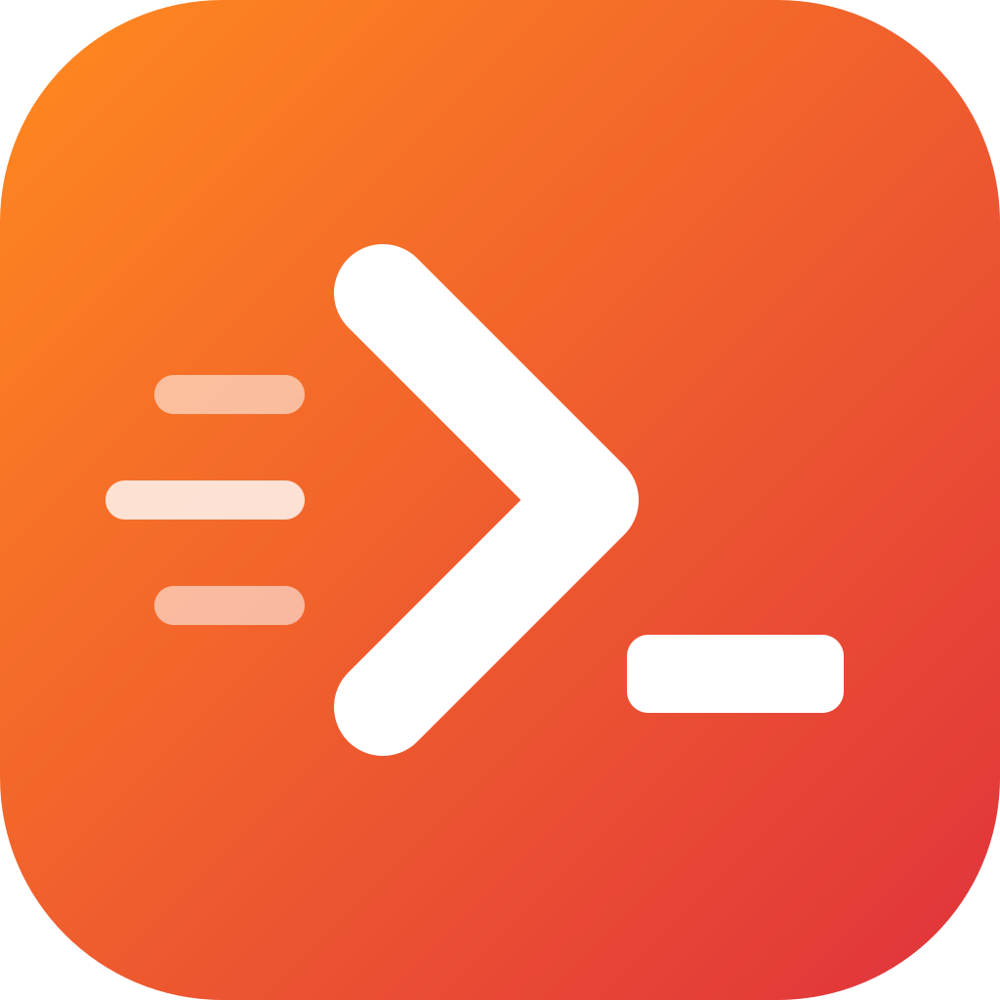
</p>

<h1 align="center">LinuxRunner</h1>

<p align="center"><b>Run real ARM64 Linux on your iPhone and iPad.</b><br>
Terminals, package managers, full desktops and GPU-accelerated apps, with no jailbreak.</p>

<p align="center">
  
  
  <a href="LICENSE.md"></a>
</p>

<p align="center">
  <a href="https://github.com/jacktembo/LinuxRunner/releases">Download</a> ·
  <a href="#install">Install</a> ·
  <a href="#first-steps">First steps</a> ·
  <a href="docs/TROUBLESHOOTING.md">Help</a> ·
  <a href="docs/BUILDING.md">Build from source</a>
</p>

---

LinuxRunner is an iOS and iPadOS app that runs ARM64 Linux programs directly on your device. Pick a distribution such as Debian, Ubuntu, Arch Linux ARM or Fedora, and you get its real package manager, real binaries and a real desktop you can use on the phone or on an external display.

There is no virtual machine and no Linux kernel inside the app. LinuxRunner reads Linux programs, runs their ARM64 instructions in its own interpreter (or an optional JIT), and answers their system calls with a compatibility layer built on iOS.

[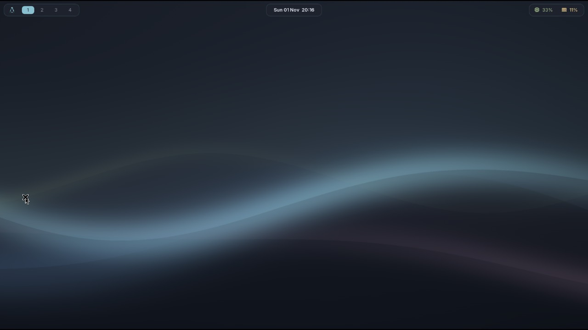](assets/screenshots/desktop/hyprland-metal.jpg)

<sub>Hyprland on Arch Linux ARM with Metal GPU acceleration (experimental, needs 8 GB RAM).</sub>

## Contents

- [Features](#features)
- [LinuxRunner Modes](#linuxrunner-modes)
- [Screenshots](#screenshots)
- [Requirements](#requirements)
- [Install](#install)
- [First steps](#first-steps)
- [Distributions](#distributions)
- [Desktop environments](#desktop-environments)
- [Using LinuxRunner](#using-linuxrunner)
- [How it works](#how-it-works)
- [Limitations](#limitations)
- [FAQ](#faq)
- [Getting help](#getting-help)
- [Building from source](#building-from-source)
- [Contributing](#contributing)
- [License and credits](#license-and-credits)

## Features

| Feature | What you get |
| --- | --- |
| **Ten Linux distributions** | Debian 13, Ubuntu 24.04, Zorin OS 18, Pop!_OS 24.04, Void Linux, Arch Linux ARM, Fedora 44, Kali 2026.3, Alpine 3.24 and experimental SteamOS ARM64. Each keeps its own packages and user accounts. |
| **LinuxRunner Modes** | Six optional modes: AI coding agents, RDP, SSH, a web preview server, a Wi-Fi file server and a retro game lab. |
| **Native terminal** | Sharp text on true black, with a two-row key bar for Esc, Tab, Ctrl, Alt, arrows, Home, End, Page Up, Page Down and clipboard. |
| **Linux desktops** | LinuxRunner Desktop, Xfce, MATE, Cinnamon, Budgie, LXQt, Zorin Desktop, Ubuntu GNOME, Enlightenment and KDE Plasma, plus experimental COSMIC, Wayfire and Hyprland. |
| **CPU & Memory, Task Manager** | Choose how many CPU cores and how much memory Linux may use, and see what each Linux process uses. |
| **Metal GPU acceleration** | A virtual Linux GPU sends compatible OpenGL work to Apple's GPU through Metal. |
| **External display** | Show the desktop on a monitor or AirPlay receiver at the screen's own refresh rate (up to 120 Hz) and use your iPhone as a trackpad. |
| **Optional JIT** | Faster execution for long-running programs when iOS allows it. The interpreter always works without it. |
| **Files and networking** | Import and export files, a shared folder per environment, normal Linux sockets over your device's connection, and optional SSH, RDP and WebDAV access on your Wi-Fi. |
| **Repair tools** | App Manager's Repair Center diagnoses and repairs package problems; desktop reports help with bug reports. |

Apps known to run include Firefox, Visual Studio Code, FreeCAD, ONLYOFFICE, Blender, Dolphin, Telegram Desktop and Vesktop (Discord). Compatibility varies by app and distribution; see [Compatibility](docs/COMPATIBILITY.md).

## Screenshots

<table>
<tr>
<td align="center" width="25%"><a href="assets/screenshots/v1.1.1/home-iphone.jpg">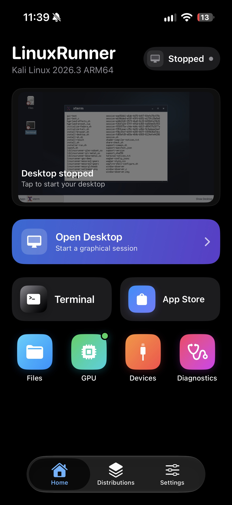</a><br><sub><b>Home</b></sub></td>
<td align="center" width="25%"><a href="assets/screenshots/v1.1.1/distributions-iphone.jpg">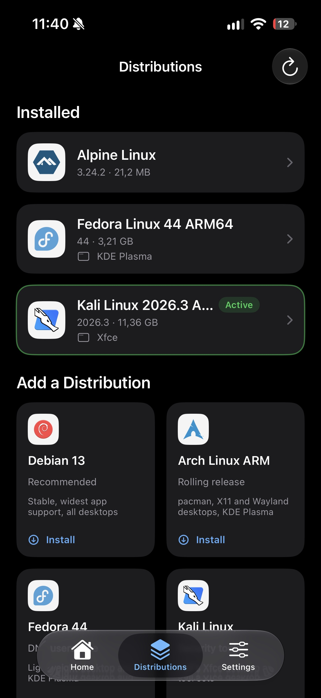</a><br><sub><b>Distributions</b></sub></td>
<td align="center" width="25%"><a href="assets/screenshots/v1.1.1/terminal-iphone.jpg">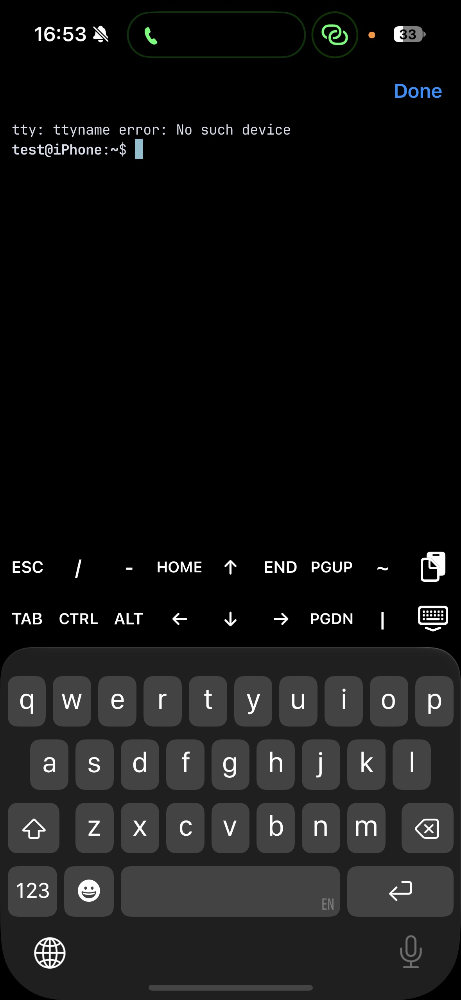</a><br><sub><b>Terminal</b></sub></td>
<td align="center" width="25%"><a href="assets/screenshots/v1.1.1/kali-desktop-viewer-iphone.jpg">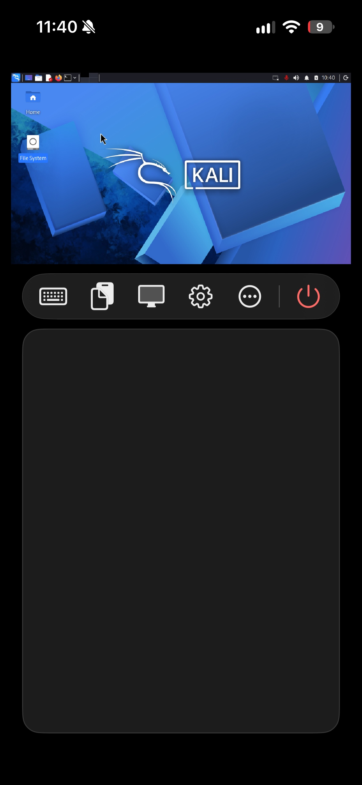</a><br><sub><b>Desktop viewer</b></sub></td>
</tr>
</table>

<table>
<tr>
<td align="center" width="50%"><a href="assets/screenshots/v1.1.1/kali-xfce-iphone.jpg">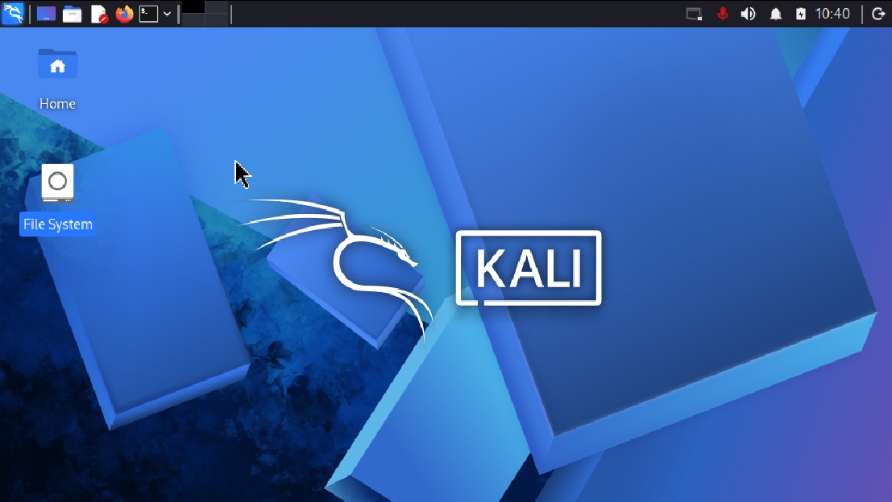</a><br><sub><b>Kali Linux · Xfce</b></sub></td>
<td align="center" width="50%"><a href="assets/screenshots/v1.1.1/fedora-kde-plasma.png">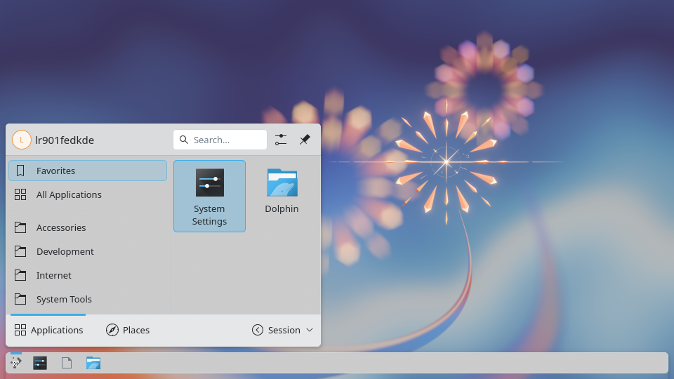</a><br><sub><b>Fedora · KDE Plasma</b></sub></td>
</tr>
<tr>
<td align="center"><a href="assets/screenshots/applications/vscode.jpg">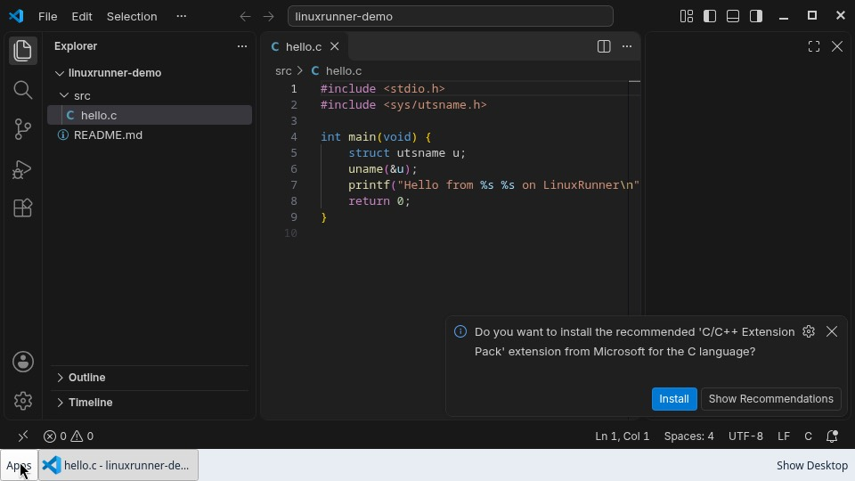</a><br><sub><b>Visual Studio Code</b></sub></td>
<td align="center"><a href="assets/screenshots/applications/firefox-github.jpg">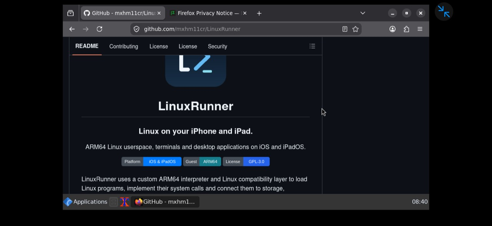</a><br><sub><b>Firefox</b></sub></td>
</tr>
<tr>
<td align="center"><a href="assets/screenshots/applications/freecad-metal-iphone.jpg">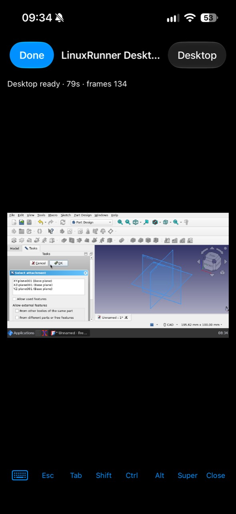</a><br><sub><b>FreeCAD with Metal</b></sub></td>
<td align="center"><a href="assets/screenshots/desktop/dex-external-display.jpg">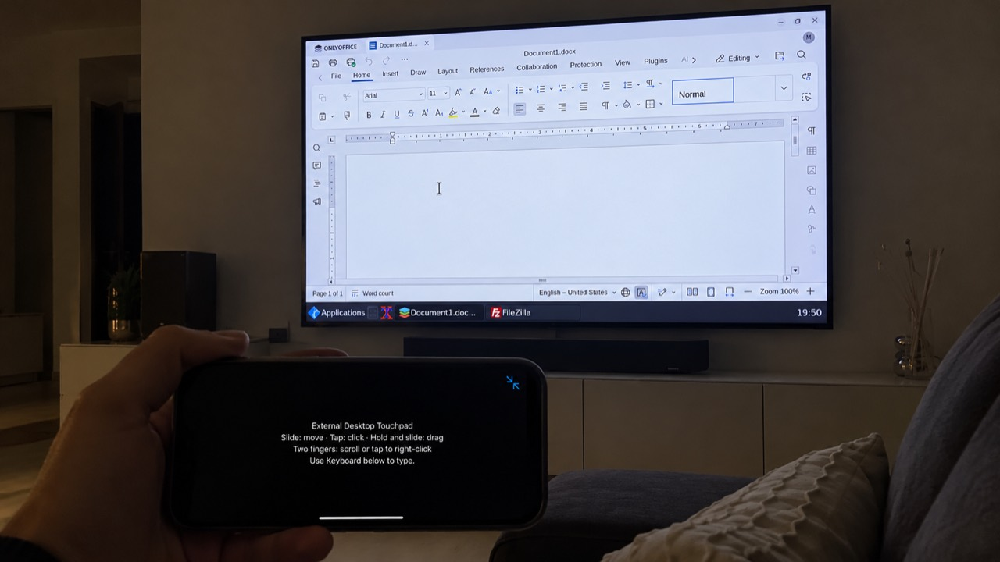</a><br><sub><b>External display with ONLYOFFICE</b></sub></td>
</tr>
</table>

<table>
<tr>
<td align="center" width="50%"><a href="assets/screenshots/v1.1.2/zorin-desktop.jpg">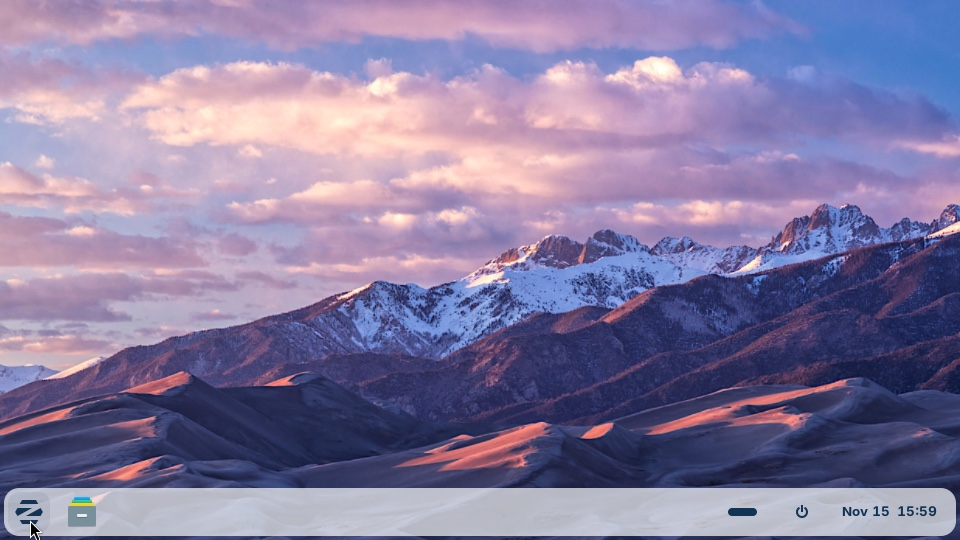</a><br><sub><b>Zorin OS · Zorin Desktop</b></sub></td>
<td align="center" width="50%"><a href="assets/screenshots/v1.1.2/ubuntu-gnome.jpg">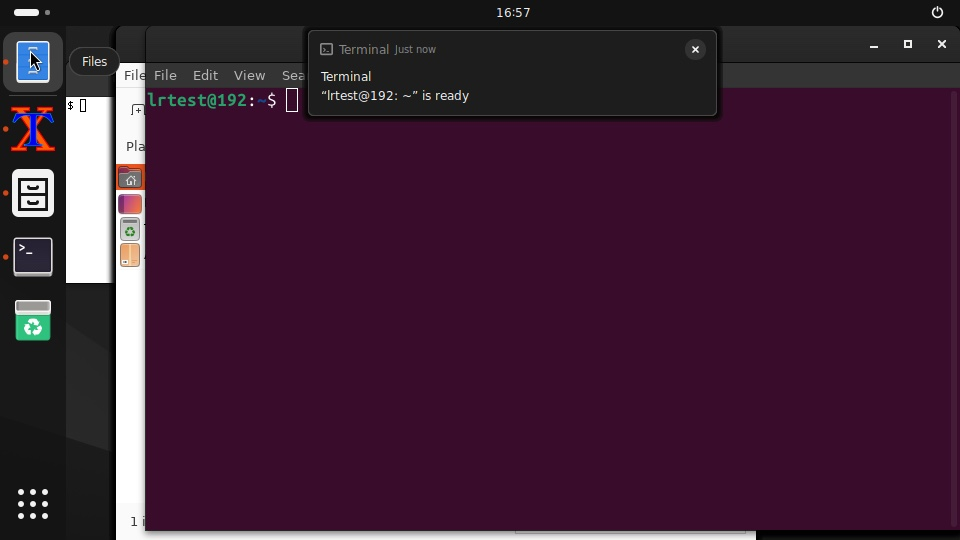</a><br><sub><b>Ubuntu · GNOME</b></sub></td>
</tr>
<tr>
<td align="center"><a href="assets/screenshots/v1.1.2/pop-xfce.jpg">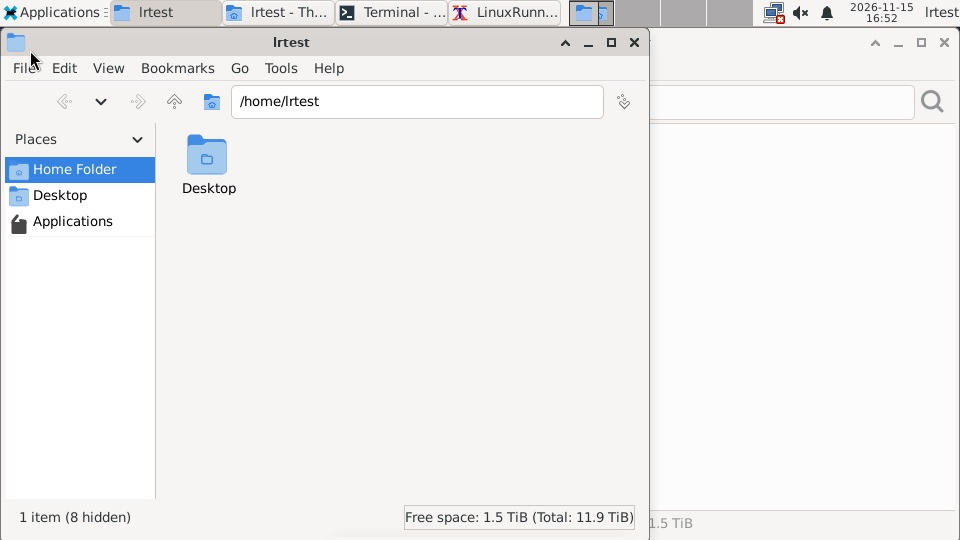</a><br><sub><b>Pop!_OS · Xfce</b></sub></td>
<td align="center"><a href="assets/screenshots/v1.1.2/void-xfce.jpg">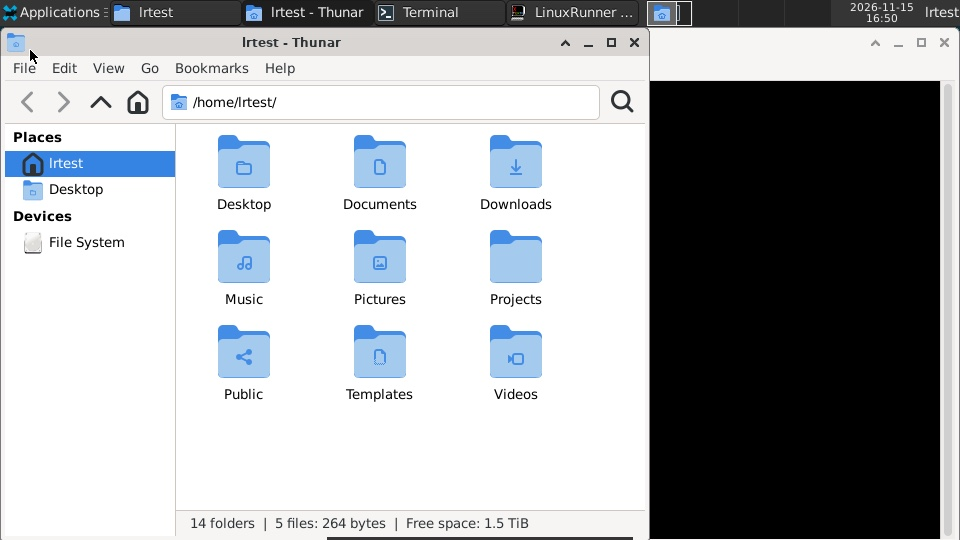</a><br><sub><b>Void Linux · Xfce</b></sub></td>
</tr>
<tr>
<td align="center"><a href="assets/screenshots/v1.1.2/debian-mate.jpg">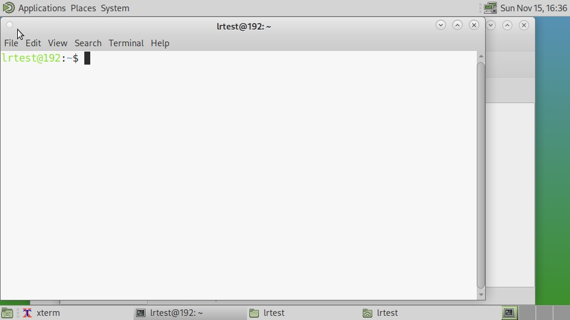</a><br><sub><b>Debian · MATE</b></sub></td>
<td align="center"><a href="assets/screenshots/v1.1.2/debian-budgie.jpg">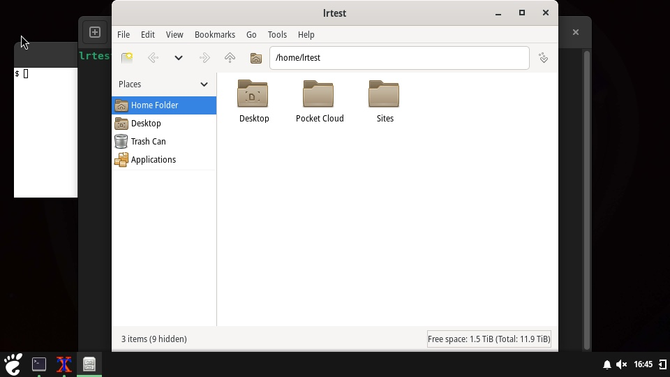</a><br><sub><b>Debian · Budgie</b></sub></td>
</tr>
</table>

More captures are in [assets/screenshots](assets/screenshots/README.md).

## LinuxRunner Modes

Six optional ways to use the Linux on your device, in **Settings → General → LinuxRunner Modes**. Every mode is off until you install and start it, and everything stops when Linux stops.

| Mode | What it does |
| --- | --- |
| **Agent Mode** | Claude Code, Codex CLI and OpenCode in your Linux terminal, with Node.js, git, ripgrep and Python. **Open Agent Terminal** starts them in `~/Projects` as your Linux user. Each agent signs in with your own account; LinuxRunner never sees your keys. |
| **RDP Mode** | Use the desktop running on your iPhone from Windows Remote Desktop, Microsoft's Windows App or Remmina. The phone and the computer control the same desktop. |
| **SSH Mode** | An OpenSSH server on port 2222 for terminals, VS Code Remote-SSH, scp, rsync and SFTP. Root login is refused. |
| **Liftoff** | Serves `~/Sites` on port 8080. Open it in Safari on the device, or scan the QR code from another device on the same Wi-Fi. |
| **Pocket Cloud** | A Wi-Fi file server: `~/Pocket Cloud` is shared over WebDAV on port 8081 with a new password at every start. Connect from Finder, the Files app, Windows or a browser. |
| **Arcadia** | RetroArch with the classic-console emulators your distribution offers. No games are included. |

RDP Mode shares the running desktop, so open the desktop in LinuxRunner first. Network modes are reachable only from devices on the same Wi-Fi, while LinuxRunner is open or running in the background. Gemini CLI is not offered in Agent Mode because it needs WebAssembly, which Node.js cannot use under LinuxRunner's interpreter.

## Requirements

| | Minimum | Recommended |
| --- | --- | --- |
| **Device** | iPhone 11 or newer, or a comparable iPad | iPhone 12 Pro or newer, or a device with more memory |
| **Memory** | 4 GB RAM | 6 GB RAM or more (8 GB for Hyprland) |
| **System** | iOS or iPadOS 15.0 | iOS or iPadOS 26 or newer |
| **Free storage** | About 3–4 GB | 10 GB or more for desktops and large apps |

Most testing happens on recent iOS releases. iOS 15 is the build target but has had little testing, and one report of a black screen at launch on an iPhone 11 with iOS 17 is still open. Large installations can need well over 10 GB.

## Install

LinuxRunner is distributed as an IPA file that you sideload. It is not in the App Store.

1. Download the latest `.ipa` file from [GitHub Releases](https://github.com/jacktembo/LinuxRunner/releases).
2. Install it with a sideloading tool such as [SideStore](https://sidestore.io), [AltStore](https://altstore.io) or [Sideloadly](https://sideloadly.io).
3. Open LinuxRunner.

**About signing:** with a free Apple ID, iOS requires you to re-sign the app every 7 days. A paid Apple Developer account extends this to one year. Keep the same signing identity when you update, so your Linux environments stay in place.

The latest published release is 1.1.1. Version 1.1.2, described here, is on `main` and can be [built from source](#building-from-source) until its release is published.

You do **not** need JIT to install or use LinuxRunner. Back up important files before updating. Details: [Installation and signing](docs/INSTALLATION.md).

## First steps

Installing the app and installing Linux are two separate steps.

1. Open the **Distributions** tab and choose a distribution under **Add a Distribution**. Debian or Arch Linux ARM are the best choices for desktop use; Ubuntu, Zorin OS, Pop!_OS and Void Linux are experimental; Alpine is a small terminal-only environment.
2. Review the download size and storage, then tap **Install**.
3. Keep the app open while it sets up the system. If it asks you to restart LinuxRunner, do so; setup resumes on its own.
4. On **Your Account**, create a Linux user. Turn on **Administrator (can use sudo)** if you want to install packages.
5. On **Choose a desktop**, pick one of the desktops your distribution offers and install it, or tap **Later** to stay terminal-only. Each distribution starts with its own default, such as Zorin Desktop on Zorin OS or Xfce on Kali, Pop!_OS and Void.
6. From **Home**, open **Terminal**, or tap **Open** on the Desktop card. **Home** also has the App Store, Files, Graphics, Devices, Diagnostics, CPU & Memory and Task Manager.

Try a few commands in the terminal:

```sh
cat /etc/os-release   # which distribution you are running
uname -m              # prints aarch64
sudo apt update       # Debian, Ubuntu, Zorin OS, Pop!_OS and Kali; use pacman, dnf, xbps-install or apk on the others
```

Full walkthrough: [Getting started](docs/GETTING_STARTED.md) · [User guide](docs/USER_GUIDE.md)

## Distributions

| Distribution | Package manager | Desktops | Status |
| --- | --- | --- | --- |
| **Debian 13** | `apt` | LinuxRunner Desktop, Xfce, MATE, Cinnamon, Budgie, LXQt; experimental KDE Plasma and Wayfire | Recommended. Widest app support. |
| **Ubuntu 24.04** | `apt` | Ubuntu GNOME, Xfce, MATE, Cinnamon, Budgie, i3 | Experimental. Canonical's Ubuntu Base. |
| **Zorin OS 18** | `apt` | Zorin Desktop (default), Xfce | Experimental. Ubuntu base with Zorin OS's repositories, themes and wallpaper. |
| **Pop!_OS 24.04** | `apt` | Xfce (default); experimental COSMIC | Experimental. Ubuntu base with System76's repository and look. |
| **Void Linux** | `xbps` | Xfce | Experimental. Independent, very light rolling release. |
| **Arch Linux ARM** | `pacman` | LinuxRunner Desktop, LXQt, Enlightenment, KDE Plasma, Wayfire; experimental Hyprland | Recommended for newer packages. |
| **Fedora 44** | `dnf` | Lightweight GTK desktop, KDE Plasma | Official Fedora image. Sound not yet tested. |
| **Kali Linux 2026.3** | `apt` | Xfce, optional tool sets | Official root filesystem. Large tool sets install slowly. |
| **Alpine 3.24** | `apk` | Limited | Small terminal environment. |
| **SteamOS ARM64** | `pacman` (inspection only) | Plasma on X11 | Experimental. See below. |

Only one environment runs at a time. To switch, choose **Use on Next Launch** and relaunch the app.

**Kali Linux** is provided for development, diagnostics and authorised security research. Without a Linux kernel, monitor-mode Wi-Fi, USB wireless adapters, raw packet capture and kernel modules are unavailable.

**SteamOS ARM64** is an experiment and has no connection to official SteamOS support. Installing downloads Valve's SteamFrame recovery image (4.07 GB), verifies it, and extracts its ARM64 system. You need about 19.4 GB free during installation and 8.9 GB afterwards. The Steam client, gamescope, Vulkan and Windows games do not work. Details: [SteamOS](docs/STEAMOS.md).

## Desktop environments

Choose a desktop in **Settings → Desktop Environment**. The screen lists only the desktops your distribution can install and start. Tap one to select it; if it is not installed yet, LinuxRunner asks before downloading it and shows each step as it installs. The choice applies the next time the desktop starts, so save your work and stop the running desktop before switching.

| Desktop | Status |
| --- | --- |
| **LinuxRunner Desktop** | Default. Lightweight Openbox session with a panel and file manager. Also the fallback if another desktop fails. |
| **LXQt** | Full X11 desktop with PCManFM-Qt and QTerminal. Best on Debian or Arch. |
| **Xfce** | Debian, Ubuntu, Pop!_OS, Zorin OS, Void and Kali (Kali's own desktop). |
| **Zorin Desktop** | Zorin OS's own GNOME-based desktop with the Zorin menu, taskbar and themes. Needs a lot of memory. |
| **MATE, Cinnamon, Budgie** | Debian and Ubuntu, from the distribution's own packages. |
| **COSMIC** | Experimental, Pop!_OS only. The desktop and apps run on the GPU; its panel and dock are not shown yet. |
| **Enlightenment** | Works on Arch. Disabled on Debian, where it stops at the splash screen. |
| **KDE Plasma** | Experimental on Debian, Arch and Fedora, with Dolphin and Konsole. Menus respond slowly. |
| **Wayfire** | Experimental Wayland compositor on Debian and Arch. GPU support on Arch. |
| **Hyprland** | Experimental. Arch only, needs 8 GB RAM, Metal recommended. The first launch may need **Retry**. |

Controls and recovery: [Desktop controls](docs/DESKTOP_CONTROLS.md)

## Using LinuxRunner

### CPU & Memory and Task Manager

Open **Home → CPU & Memory** (also in **Settings → Graphics & Performance**) to choose how much of your device Linux may use. **CPU Cores** is Automatic (4) or 1 up to your device's core count. **Linux Memory** is Automatic or 1 GB up to the device's limit: 2 GB on a 4 GB device, 3 GB on 6 GB, 4 GB on 8 GB, and 8 GB on devices with 12 GB or more. Changes apply the next time LinuxRunner starts. **Home → Task Manager** shows which Linux processes use the CPU and memory.

### GPU acceleration with Metal

Compatible Linux graphics run on Apple's GPU through this chain:

```text
Linux app (OpenGL) → Mesa virgl driver → virglrenderer → ANGLE → Metal → Apple GPU
```

Open **Settings → Graphics** (or **Home → Graphics**). The top of the screen shows whether the Metal GPU is active. Under **Linux GPU**, **Automatic** starts the virtual GPU and falls back to software rendering if it cannot; **Metal GPU** and **Software** force one or the other. **Applications** chooses how programs opened from LinuxRunner draw, and **Live** shows what the running desktop and each OpenGL program use. Desktops drawn by the GPU are shown straight from the virtual GPU, which keeps window dragging light. After changing the setting, fully close and reopen LinuxRunner. Not every app or graphics API is accelerated, and Vulkan is not generally available. Measurements: [Performance](docs/PERFORMANCE.md).

### JIT (optional)

LinuxRunner always works with its built-in interpreter. JIT translates guest code into native instructions and can speed up long-running work; short programs can be slower because translation takes time.

To try it, enable **Settings → Advanced → Developer Mode**, then open **Execution Engine / StikDebug**. It shows the JIT status and lets you pick **Interpreter**, **Automatic** or **JIT**. iOS must permit JIT, which depends on your iOS version, signing and activation method (for example [StikDebug](https://github.com/StephenDev0/StikDebug)). If iOS refuses, the interpreter keeps running. Details: [JIT on iOS](docs/engine/IOS_JIT.md).

### External display and iPhone trackpad

1. Connect a display with a supported adapter, or use **Control Center → Screen Mirroring** for AirPlay.
2. Turn on **Settings → Devices → External Desktop Output**.
3. Tap **Home → Open Desktop** (or **Resume Desktop**).
4. In the viewer, choose **Desktop → Use iPhone as Trackpad**.
5. Slide to move, tap to click, hold and slide to drag. Use two fingers to scroll, or tap with two fingers to right-click.

Keyboards and mice connected to the device also work. The display refreshes at its own rate, up to 120 Hz. The default desktop size is 960 × 540; change it under **Desktop → Desktop Settings… → Display**. LinuxRunner shows one desktop on one display. Plain screen mirroring shows the same image on both screens, and Miracast-only receivers are unsupported. Details: [Networking and displays](docs/NETWORKING_AND_DISPLAYS.md).

### Files

Use **Settings → File Sharing** to import and export files. Each environment has a shared folder at `/mnt/LinuxRunnerShared`, also linked as `~/Shared` when that name is free. To reach files from another computer on your Wi-Fi, start **Pocket Cloud** or **SSH Mode** in [LinuxRunner Modes](#linuxrunner-modes). Details: [File sharing](docs/FILE_SHARING.md).

### Networking

Linux programs use your device's internet connection through normal sockets. `ip addr`, `ip link` and `ip route` show the interfaces and routes iOS makes available. Linux cannot control radios or send raw packets, and Bluetooth networking is unsupported. Bluetooth serial boards can be connected in **Settings → Devices**; they reconnect automatically and are remembered.

Servers you start in Linux on `0.0.0.0` are reachable from other devices on the same Wi-Fi while LinuxRunner is open or running in the background. [LinuxRunner Modes](#linuxrunner-modes) sets up SSH, RDP, a web server and a file server for you.

## How it works

```text
 Linux programs and libraries (Debian, Ubuntu, Arch, Fedora, ...)
        │  ELF loader maps ARM64 binaries
        ▼
 ARM64 interpreter ──── optional JIT, when iOS allows it
        │
 Linux compatibility layer: processes, threads, signals, memory, files, sockets
        │                                   │
 iOS storage and networking          Desktop and graphics
                                     X11 (Xvfb + VNC) or Wayland
                                     Mesa virgl → virglrenderer → ANGLE → Metal
                                            │
                                     Native viewer, external display, touch and keyboard input
```

1. The **loader** maps Linux ARM64 executables and libraries into memory.
2. The **interpreter** runs their instructions. The optional **JIT** compiles frequently used code to native instructions.
3. The **compatibility layer** implements Linux system calls on top of iOS: processes, threads, signals, memory mappings, files and sockets.
4. Each environment has its own **root filesystem**. Linux ownership and permissions are stored in a database alongside the real files.
5. **Desktops** run on X11 (shown through a built-in VNC viewer) or on a virtual display for Wayland compositors. Graphics can use the Metal path above; a desktop drawn by the GPU is read directly from the virtual GPU, and the VNC connection then carries only input.

More detail: [Architecture](docs/ARCHITECTURE.md)

## Limitations

- **ARM64 Linux only.** No x86 programs, no Linux kernel, no kernel modules, no systemd as init and no containers such as Docker.
- **Incomplete coverage.** Some system calls, graphics features and apps are missing or partial; see the [syscall matrix](docs/SYSCALL_MATRIX.md).
- **iOS controls the app's life.** iOS can pause or close LinuxRunner. Closing the app ends running Linux programs; saved files remain.
- **Memory and heat.** Large desktops and apps can exceed the device's memory or thermal limits. Zorin Desktop and GNOME need the most.
- **Network modes are for trusted Wi-Fi.** Liftoff serves `~/Sites` without a password, and Pocket Cloud and RDP are not meant for public networks. Start them only on a network you trust, and stop them when you are done.
- **No security isolation inside the app.** Linux users and permissions help programs work correctly; they do not protect against hostile software. The iOS app sandbox is the security boundary.
- **Experimental parts.** Ubuntu, Zorin OS, Pop!_OS, Void Linux, COSMIC, Hyprland, Wayfire, KDE Plasma, SteamOS and the Metal backend are still experimental.

Full list: [Known limitations](docs/KNOWN_LIMITATIONS.md)

## FAQ

**Is this a virtual machine?**
No. LinuxRunner runs Linux programs directly through its interpreter and compatibility layer. No Linux kernel is booted.

**Do I need a jailbreak?**
No. LinuxRunner is a regular app installed by sideloading.

**Do I need JIT?**
No. The interpreter is the default and works everywhere. JIT is an optional speed-up when iOS allows it.

**Can I run x86 or Windows programs?**
No. Only ARM64 Linux programs run. Most distributions package ARM64 builds of their software.

**Can I use the Linux on my iPhone from my computer?**
Yes, on the same Wi-Fi. [LinuxRunner Modes](#linuxrunner-modes) offers SSH for terminals and VS Code, RDP for the desktop, and Pocket Cloud for files.

**Can I run AI coding agents?**
Yes. Agent Mode installs Claude Code, Codex CLI and OpenCode. They run on the interpreter, so they are slower than on a computer, and each signs in with your own account.

**Will I lose my files when I update?**
Saved files persist across normal updates. Keep the same signing identity when you update, and back up important files first.

**Why is the App Store not an option?**
App Store rules restrict apps that download code which adds new features, and they do not allow JIT. Installing whole Linux distributions and using JIT fall outside those rules, so LinuxRunner is sideloaded.

## Getting help

1. Check [Troubleshooting](docs/TROUBLESHOOTING.md) before reinstalling an environment.
2. Use **App Manager → Repair Center** to diagnose and repair packages.
3. Use **Settings → Storage & Maintenance → Export Desktop Report** to collect session details, including the Modes service logs. Check the report for personal information before you share it.
4. [Open an issue](https://github.com/jacktembo/LinuxRunner/issues/new/choose) with your device, iOS version, LinuxRunner version and build, distribution, desktop, graphics renderer and the steps that reproduce the problem.

Report security vulnerabilities privately; see [SECURITY.md](SECURITY.md).

## Building from source

You need a Mac with Xcode, Git, Python 3, Meson, Ninja, CMake, pkg-config and `ld.lld`.

```sh
git clone https://github.com/jacktembo/LinuxRunner.git
cd LinuxRunner
git submodule update --init --recursive --checkout -- deps/libapps deps/libarchive deps/glslang deps/spirv-cross
scripts/bootstrap-macos.sh
scripts/build-ipa.sh --unsigned
python3 scripts/verify-ipa.py build/releases
```

This builds the interpreter and software-rendering variant. The Metal and JIT variant needs extra graphics dependencies (virglrenderer, libepoxy, ANGLE) at pinned revisions. Full instructions, signing and the variant switches: [Building](docs/BUILDING.md).

### Project layout

| Path | Contents |
| --- | --- |
| [`asbestos/`](asbestos/) | ARM64 interpreter, instruction decoder and optional JIT |
| [`emu/`](emu/) | CPU state, memory management and floating point |
| [`kernel/`](kernel/) | Linux system call implementations: processes, signals, memory, time |
| [`fs/`](fs/) | Filesystems, `/proc`, terminals, sockets, virtual GPU and display devices |
| [`graphics/`](graphics/) | Guest graphics bridge and virgl integration |
| [`platform/`](platform/) | Host platform code for Darwin and Linux |
| [`app/`](app/) | The iOS app; [`app/LinuxRunner/`](app/LinuxRunner/) holds the Swift and Objective-C UI, installers and desktop viewer |
| [`tests/`](tests/) | Runtime, instruction and compatibility tests |
| [`scripts/`](scripts/) | Build, packaging, verification and benchmark scripts |
| [`docs/`](docs/) | User and developer documentation |

## Contributing

Bug reports, compatibility reports and pull requests are welcome. Read [Contributing](CONTRIBUTING.md) first. In short: keep each pull request focused, keep existing distributions working, and describe how you tested the change and on which device.

## License and credits

LinuxRunner is licensed under the GNU General Public License v3.0; see [LICENSE.md](LICENSE.md) and the additional App Store terms in [LICENSE.IOS](LICENSE.IOS). Bundled graphics libraries, fonts, terminals, Linux distributions, desktops and applications keep their own licenses; see [Third-party notices](THIRD_PARTY_NOTICES.md).

Maintained by **[jacktembo](https://github.com/jacktembo)**.

LinuxRunner builds on [iSH](https://github.com/ish-app/ish) by Theodore Dubois and contributors, by way of [ios-linuxkit](https://github.com/rcarmo/ios-linuxkit) by Rui Carmo and contributors. GPU acceleration uses Mesa, virglrenderer, libepoxy and ANGLE. Thanks to everyone who built them.
